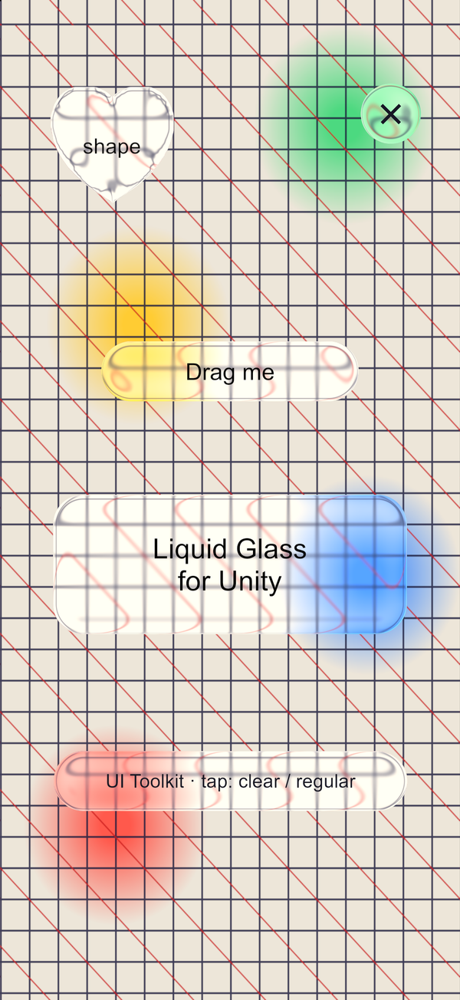
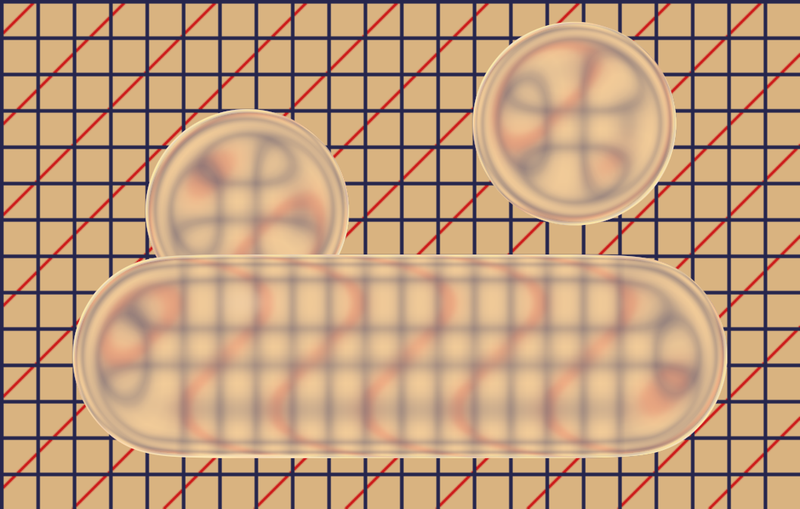
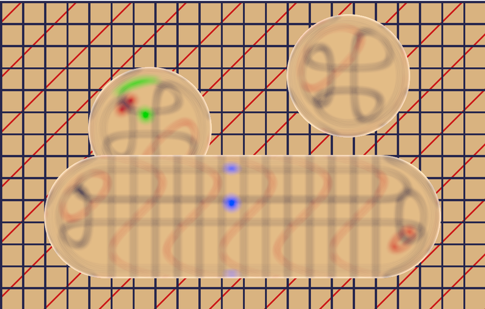

# Liquid Glass for Unity

Apple's iOS 26 Liquid Glass for Unity UI, for both uGUI and UI Toolkit. Each glass button refracts what is on screen under it, in the same frame, as Apple's does. Buttons can be any shape.

<p align="center"></p>

| Apple (SwiftUI `.glassEffect(.clear)`) | This package, default settings |
| --- | --- |
|  |  |

**[How it was made: the article, with live shaders →](https://frodiwe.github.io/UnityLiquidGlass/)** (source: [`Documentation~/index.html`](Documentation~/index.html))

## Install

Package Manager → **+** → **Install package from git URL**:

```
https://github.com/frodiwe/UnityLiquidGlass.git
```

Unity 6.3 or newer. Works with the Built-in pipeline and URP, on iOS, Android, macOS and Windows.

## Use

**uGUI.** Add **Liquid Glass Button** to a UI object that has a Graphic (an Image with no sprite will do). The object's rect becomes the glass and still takes the taps. Its children (images, text, TextMeshPro) are drawn on top of the glass.

```csharp
var glass = button.gameObject.AddComponent<LiquidGlassButton>();
glass.cornerRadius = 0;   // canvas units; 0 = pill or circle
```

**UI Toolkit.**

```csharp
using UnityLiquidGlass;

LiquidGlass.Toolkit(myButton);                     // pill or circle
LiquidGlass.Toolkit(myCard, cornerRadius: 24);     // rounded box, panel units
LiquidGlass.Toolkit(myBadge, badgeSprite);         // any shape: the sprite's outline
```

**Any shape.** Set `shape` on a Liquid Glass Button (or pass a sprite to `Toolkit`), and the glass takes that sprite's outline from its alpha, stretched over the rect. Any visible pixel counts as the shape, faint fills included. The outline is turned into a distance field once per sprite, and the sprite does not need Read/Write enabled.

The element's own background and border are replaced by the glass. Its text and children are drawn on top, and it still takes the taps.

**The look.** One look is shared by every glass shape, and you can change it at any time:

```csharp
LiquidGlass.Settings.matte = 1;          // 0 = Apple's .clear, 1 = .regular
LiquidGlass.Settings.frostRadius = 4;    // softer
LiquidGlass.Settings.lightAngle = 45;    // light from the top right
```

Every field has a tooltip. The defaults are Apple's `.clear`, read from its running `glassBackground` filter in the iOS 26 simulator and checked on probes: the glass is built in Apple's order, from the same parts:

1. The backdrop is blurred (Gaussian, σ 1.65 pt), lighter towards the outline.
2. A bezel along the outline refracts it. Its width is fixed in points (20 pt, at most 0.36 of a small shape's shorter side) and its profile is a quarter circle. The middle is flat, with no magnification.
3. One tone over what the glass shows: 0.075 + 1.04 × colour, per sRGB channel.
4. A hairline lit by two opposite lights, in a colour taken from what lies under it.

All of it works on sRGB-encoded values, as Apple's does, in Gamma and Linear projects alike.

`matte = 1` is Apple's `.regular`, measured the same way: a shallower bezel, a blur that grows with the shape, a whiter tone, a soft shadow, and on shapes under 66 pt a dark variant over dark backdrops, as Apple's small glass turns dark.

**Demo.** Package Manager → Liquid Glass → Samples → **Demo**. Add `LiquidGlassDemo` to an empty GameObject and press Play.

## How it works

1. Cameras and UI draw as usual. A glass shape and its content draw only a marker: alpha 0, with the colour left untouched.
2. At the end of the frame the finished picture is copied, and every shape is drawn over the copy with the lens (`LiquidGlass.cginc`). Its content is drawn on top, into a layer.
3. The layer reaches the screen only where a marker survived. A popup drawn over a button wrote its alpha back, so it hides both the button's glass and the button's text.

## Limits

- uGUI works on **Screen Space – Overlay** canvases only.
- Masks and RectMask2D do not clip a glass button's content.
- UI Toolkit buttons are hidden while something else on any UI Toolkit panel takes the taps at their centre, which is how a popup hides them. uGUI drawn over a UI Toolkit button does not hide it.
- To fade a UI Toolkit glass button, fade a parent element: the button's own `opacity` is set to 0.
- The UI Toolkit content copy replays backgrounds, borders and text. Custom `generateVisualContent` and vector images are not replayed.

## License

MIT
